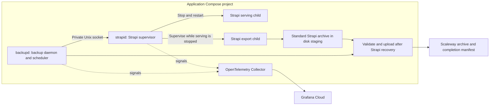

# Strapi backup design proposal

Status: proposed design for later elaboration and decomposition. Researched on
2026-10-25 and revised on 2026-10-29 against the repository's Strapi 5.52.0 and
Node.js 24 deployment. Production timings and recovery performance have not been
measured.

## Recommendation and agreed requirements

Run the Node.js backup daemon `backupd`, located in the repository-root `backupd/`
folder, and an OpenTelemetry Collector as services in the application's Compose
project. The Node.js Strapi supervisor `strapid`, located in the repository-root
`strapid/` folder, runs the existing Strapi CLI as its child and coordinates a
bounded capture window with `backupd` over a private Unix socket. Stop normal
Strapi serving and have `strapid` supervise
`strapi export --no-encrypt --no-compress` directly against production data,
without a temporary database/media copy. Resume Strapi before validating and
uploading the standard export archive to Scaleway Object Storage.

The deployment contract is `compose.yml`, `.env`, and a project-owned
`otel-config.yml` shipped alongside Compose, using the VPS's existing service
account and Rootless Docker installation. Compose defines the additional services,
project-scoped named volumes, configuration mounts, and environment wiring;
`otel-config.yml` defines the Collector pipeline. The backup solution requires no
host timers, host orchestration scripts, or additional host-service provisioning.
The VPS is shared with other applications and tenants.

`backupd` is a reasonable small Node.js project: scheduling, archive validation,
checksums, S3 uploads, and OTEL instrumentation fit the runtime. Strapi owns the
archive format and content serialization; SQLite remains opaque to the backup
subsystem. Sharing folders alone does not establish consistency.

This small site uses one administrator account shared by editors. Recovery may
recreate that account from `.env`, require API-token recreation, and lose content
attribution. These accepted limitations make Strapi export/import preferable to
preserving the complete database state. Daily backups do not depend on a custom
database archive format or on interpreting Strapi's internal schema.

| Requirement | Agreed target |
| --- | --- |
| Deployment | One shared Linux VPS; existing Rootless Docker account; Compose plus `.env` and `otel-config.yml`, SQLite, and local uploads |
| Recovery points | Daily, self-contained full snapshots; no incremental chains |
| Data loss | Target maximum 24 hours of content under normal operation |
| Expected data | 5–50 GB including uploaded media |
| Backend interruption | At most 15 minutes per scheduled capture |
| Recovery | Manual recovery by a technical operator within one day |
| Coverage | Content, media, and supported configuration in a standard Strapi-importable archive; accepted account/token and attribution exclusions |
| Project-owned runtime | Distroless and nonroot; read-only root filesystems with explicit writable data, staging, state, and coordination storage |
| Destination | Private Scaleway Object Storage over HTTPS, with bucket-level SSE-ONE |
| Telemetry | Application OTLP signals to a Collector in the same Compose project, then Grafana Cloud |
| Remote retention | Configured and owned by the operator; no application retention policy |

These are design targets, not measured guarantees. Recovery-point age starts at
capture time, not upload completion. With a precisely daily schedule, upload
latency can make the previous remote snapshot older than 24 hours before its
replacement completes. The agreed schedule is daily at a configurable UTC time,
with grace for upload latency; 24 hours remains a normal-operation target rather
than a strict remote-snapshot age ceiling. A missed run also breaks the
normal-operation assumption.

## Verified current state and recovery coverage

The repository's [backend image](backend/Dockerfile) defaults to SQLite at
`/data/cmsjs-tmpl.db`, with public files under `/data/public` and media under
`/data/public/uploads`. The [Compose configuration](compose.yml) persists `/data`
as `backend_data` and `/config` as `backend_config`. The operator confirmed that
production uses this layout.

The image already runs as a nonroot user with a read-only root filesystem.
`/config` is the XDG configuration location used by Strapi's CLI/cloud tooling;
it is not the application's configuration directory. Application configuration,
content-type definitions, bootstrap code, and dependencies are built into the
backend image. Runtime configuration is supplied through a project-local `.env`
file mounted as a Compose secret. No OTEL integration is currently defined in
the repository; the operator confirmed that no collector is running yet. The
`strapid`, `backupd`, and project Collector described below are proposed
additions, not current runtime behavior.

| State | Strapi export coverage | Recovery dependency |
| --- | --- | --- |
| Published and draft content, relations, media records | Included in the default export | Compatible application release and matching schemas |
| Upload originals and generated formats | Exports assets referenced by media records; unrelated files are outside coverage | Import content and assets from the same archive |
| Database-held settings and webhooks | Includes supported core-store and webhook configuration | Original secrets where settings depend on them |
| Admin accounts, password hashes, and API tokens | Excluded | Recreate the shared admin through bootstrap and API tokens through the admin UI |
| Content's `createdBy`/`updatedBy` attribution | Admin links are excluded | Accepted loss; recreating the admin does not restore these links |
| Application code, schemas, and configuration files | Schema descriptions are included, executable code and configuration files are not | Retained image digest and Git revision |
| Deployment secrets and host configuration | Outside the export, except values embedded in exported settings | Separate secure off-host recovery source |
| CLI state in `/config` | Not an application configuration backup | Recreate unless a concrete recovery dependency is identified |

Strapi documents the content/media/configuration coverage and the exclusion of
admin users and API tokens. Its configuration exporter reads core-store entries
and webhooks; this is narrower than backing up configuration files. See the
[export documentation](https://docs.strapi.io/cms/features/data-management/export)
and the pinned [configuration exporter](https://github.com/strapi/strapi/blob/v5.52.0/packages/core/data-transfer/src/strapi/providers/local-source/configuration.ts).
The pinned [transfer filters](https://github.com/strapi/strapi/blob/v5.52.0/packages/core/strapi/src/cli/utils/data-transfer.ts)
exclude admin records and their links; the [import documentation](https://docs.strapi.io/cms/features/data-management/import)
describes the resulting loss of `createdBy`/`updatedBy` attribution.

Keeping the original `.env` preserves configured secrets, not excluded database
records. The existing [admin bootstrap](backend/src/bootstrap/admin-user.ts)
creates the first admin only when none exists, using `ADMIN_EMAIL` and
`ADMIN_PASSWORD` (or `ADMIN_PASSWORD_FILE`). Recovery creates a new password hash
for that configured password; a password subsequently changed in the admin UI
is not recovered. API-token salts alone cannot recreate token records. The
operator must generate replacement tokens and update `CMS_API_TOKEN` in the
project-local configuration before bringing the frontend back into service.

Exports remain sensitive: database settings and webhook headers can contain
secrets. Retain the compatible application image and securely recoverable
deployment secrets separately. Do not collect the live `.env` file into a
general-purpose configuration archive.

## Implementation choices

These choices govern the later implementation; the daemons and their tooling are
not yet present in the repository.

### Runtime, packages, and tooling

Both `backupd` and `strapid` must use the same exact Node.js version as the rest
of the project, currently `24.20.0` in the root [mise.toml](mise.toml). Keep that
file project-wide: add daemon tasks there, without nested Mise configurations or
independent runtime pins. Development, CI, image preparation, and container runtime
binaries must agree on the project version. Verify the actual runtime binary;
a distroless `nodejs24` image name alone does not prove patch-version parity.

Use separate private npm packages in `backupd/` and `strapid/`, each with its own
`package.json` and committed lockfile, following the existing frontend/backend
organization. Use `npm ci` for reproducible installation.

Implement the daemons as ESM TypeScript and execute their `.ts` entrypoints
directly with Node's native type stripping. Use explicit `.ts` imports, type-only
imports, and erasable TypeScript syntax; avoid enums, parameter properties, path
aliases, runtime loaders, and a transpilation step. Keep daemon source outside
`node_modules`, where Node restricts type stripping. Run strict `tsc --noEmit`
checks separately, with `erasableSyntaxOnly` enabled, because Node does not type
check or read `tsconfig.json` at runtime. This applies to daemon code and tests;
Strapi retains the compiled JavaScript application layout described below. Keep
daemon TypeScript configuration outside `/strapi` so it does not cause the Strapi
CLI to compile the application at runtime.
[Node.js native TypeScript support](https://nodejs.org/docs/latest-v24.x/api/typescript.html)

Use `@biomejs/biome` for both daemons, matching the frontend's version, currently
`2.4.2`. Give each package a local Biome configuration following the existing
[frontend conventions](frontend/biome.json): recommended lint rules, import
organization, two-space indentation, double quotes, and semicolons. Omit the
frontend's Next.js, React, and Tailwind-specific configuration. Follow its npm
script conventions:

| Script | Command |
| --- | --- |
| `lint` | `biome check` |
| `format` | `biome format --write` |
| `typecheck` | `tsc --noEmit` |
| `check` | `npm run lint && npm run typecheck` |

Expose daemon checks, formatting, and tests through tasks in the root
`mise.toml`. CI must run the non-mutating checks and tests for both packages.

### Libraries and private coordination

Use the official AWS SDK for JavaScript v3 packages `@aws-sdk/client-s3` and
`@aws-sdk/lib-storage` for Scaleway S3 access and streaming multipart upload.
Configure the endpoint, region, explicit part size, bounded concurrency, retries,
and cancellation; preserve the provider limits and checksum requirements in the
remote artifact contract. Do not implement S3 signing or multipart orchestration.
[Official upload library](https://docs.aws.amazon.com/AWSJavaScriptSDK/v3/latest/Package/-aws-sdk-lib-storage/)

Use `node:http` with a Unix socket for JSON coordination between the daemons.
Keep the capture response open through export and service recovery, and treat
premature disconnection as cancellation of the active window. Distinguish this
from normal connection closure after a terminal result. Provide status
reconciliation by supervisor-instance and capture-window identity; a restarted
supervisor cannot confirm a previous instance's window. Configure HTTP timeouts
explicitly around the capture deadline rather than inheriting defaults that may
end a valid export early. No TCP control listener or web framework is needed.
[Node.js HTTP client socket support](https://nodejs.org/docs/latest-v24.x/api/http.html#httprequestoptions-callback)

Use `node:child_process` for direct child supervision, `node:stream` for bounded
streaming, `node:crypto` for full-file SHA-256 and run identities, filesystem APIs
for staging/state, and `AbortController` for cancellation. Use the `tar` npm
package for streaming archive inspection and metadata reading without extracting
the archive. Use official OpenTelemetry JavaScript SDKs and OTLP exporters for
the signals below, preserving the existing application/Collector ownership split.
[Archive library](https://github.com/isaacs/node-tar),
[OpenTelemetry exporters](https://opentelemetry.io/docs/languages/js/exporters/)

### Scheduling, state, and manual runs

Use Node timers for one configurable daily UTC run, with startup catch-up and
single-flight admission as described below. Do not replay missed dates. Use
small versioned JSON files in `backupd`'s state volume for scheduling and upload
reconciliation, written through atomic replacement on the same filesystem.
Local state remains subordinate to confirmed remote manifests; malformed state
cannot establish a successful backup.

Handle `SIGUSR2` in `backupd` as a manual-run request through the same admission
path. Report admission and completion through logs and telemetry. Signals
received during an active run do not queue additional work. No manual-control
socket or CLI is required, and the daemon receives no Docker-management access.

### Verification and implementation calibration

Use native `node:test`, `node:assert/strict`, and direct TypeScript execution for
both daemon test suites. Cover scheduling/catch-up, single-flight behavior,
state reconciliation, capture cancellation/deadlines, archive rejection, and
manifest-last publication once at their owning boundaries. Cover advisory
severity detection with recognized markers and unfamiliar output, successful
publication despite advisory diagnostics, and aggregation into one attention
event per run; do not assert Strapi's exact log prose. Integration tests
cover material socket, child-process, filesystem, or storage behavior that lower
boundaries cannot prove. Supervisor integration tests use fixture children;
do not introduce automated Strapi backend tests. Strapi verification remains
startup from an empty database and the manual recovery procedure below.
[Node.js test runner](https://nodejs.org/docs/latest-v24.x/api/test.html)

Before rollout, finalize the UTC run time, staging disk allowance,
exporter-termination and recovery reserves within the 15-minute budget, bounded
upload retry settings, and service-specific variable/secret wiring. Confirm the
selected SDK checksum mode against Scaleway during storage integration; an
S3-compatible test dependency alone cannot establish provider compatibility.
Calibrate timing and capacity against measured export/upload behavior without
relaxing capture consistency or the recovery budget.

## Alternatives

### Scheduling and deployment portability

| Concern | Separate Node.js `backupd` in Compose — recommended | External systemd timer |
| --- | --- | --- |
| Deployment | Starts with the application from Compose, `.env`, and the shipped `otel-config.yml` | Requires separately installed units and orchestration |
| Missed schedules | Persist completion state; run one overdue backup on startup | Catch-up depends on timer configuration |
| Overlap | One `backupd` instance and one execution path for scheduled/manual requests | Separate coordination is needed across timer and manual invocations |
| Capture timeout | `strapid` owns recovery independently of `backupd` | Host orchestration owns recovery independently of the capture worker |
| Backend stop/start and export | `strapid` supervises its serving and export children | Typically requires host-level container lifecycle operations |
| Availability evidence | `backupd` heartbeat, backup freshness, and `strapid` recovery outcomes | Job outcomes and backup freshness |

An external timer does not meet the agreed deployment contract. A user-level
timer would avoid global systemd changes but would still add provisioning outside
Compose. Scheduling inside the backend container was also considered; the
separate service keeps scheduling, validation, uploads, and storage credentials
apart from `strapid`.

### Compose services and private coordination

- **`backupd` (`backupd/`):** the backup daemon owns the schedule, startup catch-up,
  single-flight execution, run staging allocation/cleanup, archive validation,
  upload, and remote completion.
  It requests export through `strapid` and does not access production data.
  Persist scheduling state and the last remotely completed capture in a named
  volume. After downtime, reconcile any interrupted completion and run one backup
  if overdue; do not replay a backlog of missed dates. Scheduled and manual
  requests use the same single-flight path. Local state cannot turn an unconfirmed
  upload into success.
- **`strapid` (`strapid/`):** the Strapi supervisor is a small Node.js entrypoint
  that runs the existing Strapi CLI directly as serving or export child processes,
  never concurrently. It owns graceful serving shutdown, capture-window admission,
  export supervision and log forwarding, deadline enforcement, restart,
  and recovery checks.
  It has no schedule or storage credentials and needs no Strapi control endpoint
  or changes to Strapi's application/bootstrap internals.
- **Collector:** receives `backupd` and `strapid` OTLP signals on the Compose network
  and forwards them to Grafana Cloud. Keep its pipeline in the project-owned
  `otel-config.yml` beside `compose.yml`, bind-mounted read-only into the Collector.
  Compose defines the service, mount, and environment wiring, supplying only the
  required deployment values from `.env`. Keep credentials out of the YAML file.

`backupd` and `strapid` communicate through a Unix socket in a project-scoped named
volume, accessible to their nonroot users. `strapid` admits one capture window
at a time and associates requests and completion with that window's identity.
Keep the connection open during capture so disconnection ends the active window.
`strapid` controls only its own serving and export children. Neither service
receives a Docker socket, host process access, or an account-wide container
management capability. Project volumes and internal networking require no
changes to global systemd configuration or other tenants' services.

Compose restart policies recover crashed services; intentional container shutdown
must not trigger `strapid`'s capture-recovery restart path. `backupd` or Collector
unavailability must not prevent normal Strapi startup. Compose provisions the
services and storage, and `otel-config.yml` ships with the project deployment
files; the Collector requires no separately provisioned host service.

### Snapshot format

Use the default export with all stages enabled, without `--only`, `--exclude`, or
content-type filters.
`strapi export --no-encrypt --no-compress --file <staging-base>` produces an
uncompressed `.tar` archive; Strapi appends the extension. Upload that archive
unchanged, with the separate completion manifest. Do not wrap it in another
archive or implement a replacement serializer. Recover through `strapi import`,
not by copying exported files into the SQLite data directory.

A native database-and-media snapshot would preserve more internal state,
including admin accounts, password hashes, token records, and attribution. A
standard file archive could preserve this state without interpreting Strapi's
schema, but recovery would require replacing the coherent database/journal/media
set while writers are stopped. Retain this as an alternative if complete state
preservation becomes a requirement; it is not the primary recovery format here.

Run export directly against production data after normal serving and other
writers have stopped. The export instance itself loads Strapi and may write
during initialization/bootstrap; the consistency rule excludes concurrent
writers, not those supported startup writes. Keep serving stopped until export
has exited. No temporary database/media copy is part of this design.

The same interval protects database content and media from concurrent edits.
Exporting a live database or copying live media does not establish a coherent
recovery point. If measured export cannot fit the outage budget, revisit the
design within the Compose-only constraint before rollout; do not silently relax
consistency, adopt a copy strategy, or assume host filesystem snapshots exist.

Incremental replication or deduplicated backup repositories are unnecessary for
the agreed independently restorable full artifacts. General VPS backups can
complement this proposal but do not establish the required application recovery
coverage on their own.

### Strapi-export feasibility

The selected export path requires additional runtime preparation:

- The CLI creates another Strapi instance. Its helper calls `compileStrapi()`
  and then `load()`, which performs database initialization/schema synchronization
  and plugin/application bootstrap. This is not a passive reader. In this project,
  bootstrap can provision the default admin and create or reconcile the Next.js
  webhook. See the pinned [CLI helper](https://github.com/strapi/strapi/blob/v5.52.0/packages/core/strapi/src/cli/utils/data-transfer.ts)
  and [Strapi lifecycle](https://github.com/strapi/strapi/blob/v5.52.0/packages/core/core/src/Strapi.ts).
- Extend the existing `backend/Dockerfile` and use its included Strapi CLI for
  serving, export, and import. Build once in its `build` stage and package the
  emitted JavaScript, content-type/component JSON, and admin bundle in the
  distroless runtime, alongside matching dependencies, package metadata, and
  required runtime assets. Mounting only `/data` and `/config` into an unrelated
  Node.js image is insufficient.
- Package `/strapi` as the compiled application's root: copy `dist/config/` to
  `/strapi/config/`, `dist/src/` to `/strapi/src/`, and `dist/build/` to
  `/strapi/build/`. Include compiled database migrations when present, plus
  `package.json`, `node_modules/`, public assets, and the favicon. Keep the
  TypeScript sources and `tsconfig.json` in the build stage. `start` loads this
  JavaScript layout directly; export/import still call `compileStrapi()`, but
  that helper skips compilation when the application has no `tsconfig.json`.
  See the pinned [start command](https://github.com/strapi/strapi/blob/v5.52.0/packages/core/strapi/src/cli/commands/start.ts)
  and [compiler](https://github.com/strapi/strapi/blob/v5.52.0/packages/core/core/src/compile.ts).
- Keep `/strapi` read-only. Export/import diagnostics are written in the process
  working directory, which is also how the CLI locates the application. Have
  `strapid` create a small per-invocation writable directory under `/tmp`, with
  symlinks to the immutable application's compiled directories, dependencies,
  package metadata, and runtime assets, and use it as the export/import child's
  working directory. Keep `ENV_PATH`, database/media paths, and archive paths
  absolute. Invoke `/nodejs/bin/node` with
  `/strapi/node_modules/@strapi/strapi/bin/strapi.js` and the requested command
  directly, without a shell, `npm`, or `npx`. This workspace holds diagnostics,
  not another application build or a database/media copy; the archive remains
  in disk-backed staging. Remove the workspace after child exit; its diagnostic
  files are not parsed or ingested separately from console output. See the CLI
  helper above.
- Missing assets can produce warnings and be skipped. Entity-read failures can
  also be reported as warnings with remaining entities skipped, even when the
  CLI exits successfully. This is an accepted limitation of the CLI-based design:
  a successful backup establishes that export, capture, recovery, archive
  validation, and remote publication checks passed; it does not independently
  prove that every source record and asset was included. Diagnostics are advisory
  and must not gate publication. Neither archive integrity nor checksums nor the
  absence of recognized warning markers proves source completeness. This behavior
  is visible in the pinned [asset provider](https://github.com/strapi/strapi/blob/v5.52.0/packages/core/data-transfer/src/strapi/providers/local-source/assets.ts)
  and [entity provider](https://github.com/strapi/strapi/blob/v5.52.0/packages/core/data-transfer/src/strapi/providers/local-source/entities.ts).

Direct export intentionally gives the export instance access to the production
database and media, including bootstrap's supported writes. `strapid` must
supervise the exporter for the entire capture window. Loading, bootstrap, export,
termination, and service recovery all consume the interruption budget; application
compilation happens only during image build. These runtime requirements do not
authorize a Strapi upgrade.

## Proposed lifecycle and container boundaries

1. **Preflight and exclude concurrent work.** `backupd` admits one run, checks
   staging capacity, and establishes the active release, source-volume identity,
   and export runtime readiness with `strapid`. Check destination access
   before requesting an interruption. A stopped or unavailable backend is not
   an acknowledged capture window; wait or report failure without taking over
   its container.
2. **Acquire a bounded capture window.** `strapid` admits the request, starts
   its independent deadline, and stops its serving child gracefully. Acknowledge
   capture only after the child has exited and no other writer can access the
   database/media set. A failed or forced serving shutdown aborts the attempt
   and starts recovery rather than being treated as a clean export opportunity.
3. **Export locally.** `strapid` starts the matching Strapi export CLI as its
   supervised child against production data, writing the uncompressed export to
   the run's disk-backed staging location. Use bounded memory. A nonzero exit,
   signal termination, or supervisor-observed capture I/O failure invalidates
   the capture. Handle log diagnostics as advisory signals as described below.
   Wait for exporter exit and closed output before accepting the artifact; the
   serving process stays stopped throughout.
4. **Resume and confirm service.** After exporter exit, `strapid` restarts
   serving and checks the child plus its existing `/_health` response, including
   after a failed export. `backupd` needs a result tied to the current window
   confirming successful CLI exit, capture within the valid window, and service
   recovery before upload. A missing acknowledgement must be reconciled by window
   identity; unknown or expired outcomes cannot authorize publication. Service
   recovery alone does not make a failed export valid.
5. **Validate and upload.** After Strapi has resumed, validate the staged archive,
   finish its full-file checksum, and upload it with bounded retries.
   Use an established archive reader to check tar integrity and read Strapi's
   export metadata. Reject invalid or truncated archives and archive-read
   failures. Combine these checks with `strapid`'s confirmed capture and recovery
   result; CLI success and archive validation do not prove source completeness.
   Do not parse SQLite or implement a parallel Strapi schema validator. Remote
   work never extends the outage.
6. **Record completion and clean staging.** Publish the remote completion record
   only after artifact upload and confirmation, then persist the successful
   scheduling state. Emit outcomes and remove the run's local staging. Permit a
   bounded retry of a completed local artifact while keeping local disk use capped.
   Advisory diagnostics do not block manifest publication or advancement of the
   last remotely completed capture timestamp.

The 15-minute limit includes serving shutdown, export startup and execution, and
serving recovery. `strapid` reserves exporter-termination and restart time,
ending export before the full budget is consumed. `backupd` disconnection,
cancellation, or deadline expiry invalidates the active window and makes
`strapid` terminate the exporter and attempt recovery independently. Use bounded
graceful termination followed by forced termination when necessary, and confirm
that the exporter and any subprocesses have exited before restarting serving.
If termination cannot be confirmed, report a recovery failure rather than start
concurrent access. An archive from an invalid window must be discarded even if
the exporter later exits successfully. `strapid`/container replacement also
invalidates an outstanding window; never accept a stale result for a newer run
or adopt an orphaned partial archive after restart.

If restart fails, prioritize bounded recovery attempts and an urgent failure
signal; do not continue the normal upload flow or report an overall successful
run. A stopped VPS or failed `strapid`/container runtime can still require operator
recovery; the 15-minute budget is not a host-failure availability guarantee.

`strapid` owns source-writer exclusion, export execution, log forwarding/advisories,
and Strapi recovery; `backupd` owns archive validation, upload, and staging cleanup
after `strapid` has relinquished the run. The backend retains its writable
production data mount and receives narrowly writable export runtime paths and
shared disk-backed archive staging. `backupd` receives that staging and its
own state storage, but no production data mount or Strapi secrets. Never clean
or reuse a run's staging while its exporter may still be writing. A small
coordination volume holds the private socket. Grant the necessary named-volume
permissions through the container images and Compose so their nonroot users work
under Rootless Docker without host ownership changes. Do not stage 5–50 GB in
RAM-backed `/tmp`.

Supply service-specific settings from the single project-local `.env`: storage
credentials belong to `backupd`, Grafana forwarding credentials to the Collector,
and Strapi settings to the backend. The current shared environment-file mount
must not cause newly added storage/forwarding credentials to be distributed to
every service. Exact runtime variable and secret wiring is deferred to elaboration.
Project-owned images remain distroless, nonroot, and read-only except for their
required writable volumes and temporary scratch. No privileged container or
`sudo` is required.

`backupd` and `strapid` expose no public control service. Collector listeners use
the permitted 65100–65199 range on the private application network; any published
host port binds explicitly to `127.0.0.1`. Keep application telemetry inside this project's
network; no host log directories or other tenants' log access is needed. Machine and
user environment variables remain untouched. Third-party Collector images follow
their supported runtime requirements rather than the project's custom
image-hardening rules.

## Remote artifact contract

Each recovery point consists of the unmodified Strapi `.tar` export and a small
completion manifest under a unique snapshot identity. The manifest identifies
the artifact as a Strapi export, not a native SQLite snapshot; it does not alter
the archive's format. Include a UTC capture timestamp and collision-resistant
run identity; retries must not overwrite an unrelated recovery point. The manifest
records the format/version, site/environment, capture interval, archive key,
byte length, full-file SHA-256, Strapi version, and application image digest/Git
revision. It contains no deployment secrets or content excerpts. This defines
the necessary information without fixing a JSON schema or object-key layout.

Upload the archive first and publish the manifest last. A lone archive or partial
multipart transfer is not a completed backup. Confirm remote object existence
and length before committing the manifest, then confirm the manifest write.
If an acknowledgement is lost, reconcile that run's identity rather than assume
success or create an overwrite. The manifest is authoritative; a mutable
`latest` pointer is unnecessary for v1.

Scaleway limits multipart part numbers to 1–1,000. Choose part size from the known
archive size so the upload fits that limit and the provider's part-size limits;
do not inherit an AWS client's larger part-count assumption. Bound upload
concurrency and retry duration, and abort the current multipart upload on handled
failure or cancellation. An unhandled kill can leave unfinished parts for the
operator's cleanup policies. [Scaleway multipart documentation](https://www.scaleway.com/en/docs/object-storage/api-cli/multipart-uploads/)

Use a supported S3 transfer-checksum mode as well as the manifest's full-file
SHA-256. Multipart ETags are not full-file SHA-256 hashes. Scaleway distinguishes
full-object and composite checksums; its multipart SHA-256 is composite, so do
not compare it directly with the archive's full-file SHA-256. A hash supplied as
custom object metadata is not independent remote verification. Confirm the SDK's
checksum behavior against Scaleway during integration. [Supported checksums](https://www.scaleway.com/en/docs/object-storage/reference-content/supported-checksums/)

Completed uploads, transport checksums, and metadata confirmation establish that
the artifact was transferred. They do not prove that Strapi can recover its
content. On retrieval, recompute the full-file checksum before using the archive.

Use a private bucket and a dedicated application credential scoped to the backup
destination and required upload/confirmation operations. It does not need bucket
administration, retention management, or deletion of completed backups. Keep
recovery access available independently of a failed VPS. Bucket-level SSE-ONE
must be enabled by the operator before the first upload; it encrypts newly
uploaded objects with Scaleway-managed keys. HTTPS protects transport, while
local staging remains sensitive plaintext. [SSE-ONE documentation](https://www.scaleway.com/en/docs/object-storage/how-to/enable-sse-one/)

Remote expiration, storage-class transitions, versioning, Object Lock, and orphan
cleanup policies remain operator concerns. The application neither configures
them nor implements a remote pruning job. Required storage is approximately full
snapshot size multiplied by the number retained, plus unfinished transfers and
metadata; retention choices therefore materially affect cost.

## Observability and recovery

### Signals and ownership

Send `backupd` and `strapid` OTLP signals to a Collector service in the same Compose
project and let it forward to Grafana Cloud. Use an OpenTelemetry Collector
distribution with OTLP reception/export and YAML configuration. Define the
pipeline in `otel-config.yml`, shipped beside `compose.yml` and bind-mounted
read-only into the Collector. Reference the Collector's environment for credentials
and deployment-specific values, with only the required values passed from `.env`
through Compose. No host journal or Docker log collection is required for these
application signals.
[Collector agent pattern](https://opentelemetry.io/docs/collector/deploy/agent/),
[Grafana Cloud OTLP ingestion](https://grafana.com/docs/grafana-cloud/send-data/otlp/send-data-otlp/)

| Signal | Proposed meaning |
| --- | --- |
| Structured logs | `backupd` startup/catch-up, run start, capture-window outcome, Strapi recovery outcome, remote completion, and categorized failures |
| Export logs | Secret-filtered export stdout/stderr, correlated with the run and capture window |
| Attention event | One advisory event per run with recognized warning/error severity markers, independent of the backup result |
| Traces | One run context with export, recovery, validation, and upload phases; correlate `strapid` and `backupd` outcomes |
| Heartbeat metric | Regular `backupd` availability signal independent of the daily backup schedule |
| Freshness metric | Capture timestamp of the most recent remotely completed snapshot, persisted across restarts and regularly reported; advance only after manifest confirmation |
| Outcome and duration metrics | Run result and phase durations with a small bounded outcome/phase vocabulary |

Use stable service/environment identity. Run IDs, object keys, and trace IDs may
appear in logs or traces, but must not become metric dimensions or indexed log
labels. Application instrumentation owns safe fields, filtering, cardinality,
and event meaning. Never forward archive content, environment dumps, credentials,
or signed URLs. Filter sensitive data from Strapi output before forwarding.
The Collector owns transport, routing, batching, authentication, retry queues,
and sampling; it does not repeat an application-specific field allowlist.

Forward export stdout and stderr to OTEL with run/window correlation and bounded
buffering. Recognize a small set of emitted warning/error severity prefixes as
best-effort hints for operator attention. Do not match message wording, maintain
diagnostic allowlists, or infer source completeness from output. Forward
unrecognized output under the same secret-filtering policy without failing the
backup. A recognized error marker alone is also advisory; machine-observable
failures determine acceptance.

Aggregate recognized markers into one attention event per run for operator
investigation, independent of whether the run succeeds or fails. Successful runs
with advisory diagnostics publish normally and advance freshness after manifest
confirmation. Keep this advisory separate from the backup result and freshness
signals.

`strapid` emits capture-admission, export/advisory, expiry/disconnection,
and Strapi-recovery outcomes independently of `backupd`. `backupd` emits
scheduling and backup outcomes. Propagate correlation through private
coordination so a `backupd` failure does not erase recovery evidence. Flush buffered
signals with a bounded wait on normal shutdown; a hard kill can still lose
unexported signals.
Telemetry failure must not delete or invalidate an otherwise completed remote
backup; retain a safe local operational error and rely on remote missing-data
alerts to expose observability loss. Avoid duplicate ingestion of the same `backupd`
event through both OTLP and collected stdout.

### Availability and alerts

A healthy deployment has a running `backupd`, a recent remotely completed snapshot,
and successful Strapi recovery after capture. A `backupd` heartbeat alone does not
prove that backups are completing.

- Alert on missing `backupd` heartbeat on a window appropriate to its regular
  reporting cadence, independently of daily backup freshness.
- Alert promptly on a failed run, exhausted upload retries, or failed backend
  recovery; backend recovery failure has the highest operational priority.
- Raise one advisory notification per run with an attention event, separate from
  backup-failure and freshness alerts. Multiple diagnostic lines must not produce
  multiple notifications for the same run; operators inspect the correlated
  export logs without holding up publication.
- Alert when the last confirmed snapshot is overdue. A proposed initial late-run
  threshold is 26 hours, including operational grace; it does not relax the
  24-hour content-loss target.
- Handle an entirely missing series and Collector/host telemetry loss explicitly.
  Do not let an empty query resolve the backup alert as healthy.
- Treat regular heartbeat/freshness reports separately from sparse run-outcome
  samples. Idle time between daily runs must not create a failed-backup alert.

Finalize thresholds against measured durations and the actual schedule. Grafana
documents how missing series and No Data can otherwise leave failures unnoticed.
[Missing-data alert guidance](https://grafana.com/docs/grafana/latest/alerting/guides/missing-data/)

### Manual recovery procedure

1. Select a completed snapshot manifest, recover the recorded application image
   and original deployment secrets from their separate secure source, and download
   the `.tar` archive. Verify its size and full-file SHA-256 against the manifest.
   Recovery must not depend on an earlier snapshot or the original VPS.
2. Prepare fresh destination database/media storage with suitable nonroot
   ownership and the recorded application image, matching schemas, dependencies,
   and writable CLI paths. Retain the original Strapi secrets in project-local
   configuration; do not let a newer release migrate the destination. Preserve
   existing production storage until the operator accepts the recovery. Keep
   normal serving, scheduled backups, and other writers stopped during import.
3. Run `strapi import --file <archive.tar>` in the matching application context
   against the fresh destination, with no data exclusions. In a distroless image,
   invoke the image's Node binary and Strapi CLI entrypoint directly; no shell,
   `npm`, or `npx` is required. Import replaces the selected destination's content
   and uploads, so confirm its storage identity before accepting the destructive
   prompt. Wait for successful completion and review diagnostics before serving.
   Extracting or moving exported files into `/data` does not restore SQLite.
   [Strapi import documentation](https://docs.strapi.io/cms/features/data-management/import)
4. Use the existing bootstrap to recreate the shared administrator from
   `ADMIN_EMAIL` and `ADMIN_PASSWORD` (or the separately recovered password-file
   contents). The import CLI loads Strapi and runs bootstrap, so this may already
   have happened during import; bootstrap leaves an existing destination admin
   alone. Log in with the configured password, not a later UI-only password.
   The original password hash and content's `createdBy`/`updatedBy` links are not
   recovered. Start the backend with operator access only while completing setup.
5. Create replacement API tokens through the admin UI with the permissions
   required by their consumers. Update `CMS_API_TOKEN` in the project-local
   configuration and restart the frontend; update any other token consumers.
   Keep the original Strapi salts, signing secrets, and encryption key. Replacing
   the consumer token is the intentional change to the otherwise recovered `.env`.
6. Confirm current public URLs and reconcile the managed Next.js webhook through
   normal backend bootstrap after import, so the restored webhook uses the
   configured destination and secret. Check any other restored webhooks before
   enabling traffic. Refresh frontend caches through the existing revalidation
   mechanism or a fresh frontend runtime so newer cached content does not mask
   the restored state. Manually check admin login, authenticated frontend content,
   representative draft/published content, relations, and original/generated
   media. Accept the recovered storage and resume traffic and scheduling only
   after these checks pass.

This procedure uses Strapi's recovery interface without an automated Strapi test
suite. Download time, operator work, image/secret retrieval, import, credential
recreation, and cache reconciliation all count toward the one-day recovery target.
